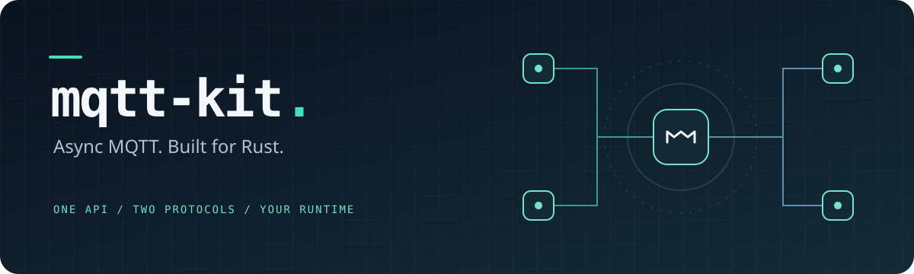

<div align="center">



# mqtt-kit

**一套 API，連接 MQTT 3.1.1 與 MQTT 5。**

以 Tokio 與 rumqttc 為基礎的非同步 Rust MQTT 工具庫，\
提供自動重連、訂閱恢復、有界訊息串流與可配置的 rustls TLS。

[](Cargo.toml)
[](#功能一覽)
[](#授權)

[快速開始](#快速開始) · [TLS 與安全](#tls-與安全) · [完整指南](docs/guide.md) · [參與貢獻](CONTRIBUTING.md)

</div>

---

## 為什麼使用 mqtt-kit？

MQTT 協定處理由 [rumqttc](https://github.com/bytebeamio/rumqtt) 負責；mqtt-kit 將連線生命週期、訊息路由及常見產品需求整合成一致的介面，讓應用專注於資料。

- **相同的操作方式** — 在執行時選擇 MQTT 3.1.1 或 5，共用發佈、訂閱與錯誤型別。
- **連線恢復** — 指數退避、隨機抖動、可設定重試上限，並依 broker session 狀態恢復訂閱。
- **可控的緩衝** — 每個訂閱都有獨立的有界佇列；慢速消費者不會阻塞網路事件迴圈。
- **低成本 payload 共用** — 使用 `bytes::Bytes`，複製訊息時共用 payload 儲存空間。
- **明確的安全設定** — rustls TLS／mTLS、自訂 CA，以及衝突設定的預先驗證。

> **專案狀態**：目前為 0.2.0 開發版，尚未發布至 crates.io。可使用本地 path 或 Git 依賴；0.x 版本的 API 仍可能調整。

## 快速開始

需要 **Rust 1.86+** 與可連線的 MQTT broker。下列依賴範例假設應用與本倉庫位於相同父目錄；請依實際位置調整 `path`。

```toml
[dependencies]
mqtt-kit = { path = "../mqtt-kit/crates/mqtt-kit" }
tokio = { version = "1", features = ["macros", "rt-multi-thread"] }
```

也可以直接使用 Git 依賴：

```toml
mqtt-kit = { git = "https://github.com/liam8846/mqtt-kit", features = ["tls-ring"] }
```

正式應用建議固定已審查的 `rev`，並保留 `Cargo.lock`。

下列範例連到本機 `127.0.0.1:1883` 的 broker，發送一筆訊息並等待回傳；本機 broker 需允許此 topic 的訂閱與發佈。

```rust
use std::time::Duration;
use mqtt_kit::{ConnectionState, MqttClient, QoS};

#[tokio::main]
async fn main() -> Result<(), Box<dyn std::error::Error>> {
    let client = MqttClient::builder("mqtt-kit-demo")
        .broker("mqtt://127.0.0.1:1883")
        .connect()
        .await?;

    // connect() 啟動背景連線；透過 state() 等待 broker 完成握手。
    let mut state = client.state();
    tokio::time::timeout(Duration::from_secs(5), async {
        loop {
            match *state.borrow_and_update() {
                ConnectionState::Connected => return Ok::<(), mqtt_kit::MqttError>(()),
                ConnectionState::Closed => return Err(mqtt_kit::MqttError::ClientClosed),
                _ => {}
            }
            state.changed().await.map_err(|_| mqtt_kit::MqttError::ClientClosed)?;
        }
    }).await??;

    let mut messages = client.subscribe("demo/hello", QoS::AtLeastOnce).await?;
    client.publish("demo/hello", "Hello, MQTT!", QoS::AtLeastOnce).await?;

    if let Some(message) = tokio::time::timeout(Duration::from_secs(5), messages.recv()).await? {
        println!("{} → {:?}", message.topic, message.payload);
    }

    client.disconnect().await?;
    Ok(())
}
```

這個範例使用本機明文連線。跨網路傳送帳密或敏感資料時，請使用下方的 TLS 設定。

## 功能一覽

| 能力 | MQTT 3.1.1 | MQTT 5 |
| :--- | :---: | :---: |
| QoS 0／1／2、retain、Last Will | ✓ | ✓ |
| Username／password 認證 | ✓ | ✓ |
| `+`／`#` wildcard 訂閱 | ✓ | ✓ |
| 斷線重連與自動重訂閱 | ✓ | ✓ |
| TLS／mTLS、WebSocket 傳輸 | ✓ | ✓ |
| User properties、content type、expiry | — | ✓ |
| Response topic、correlation data | — | ✓ |
| No-local、retain handling、subscription identifier | — | ✓ |

在 3.1.1 模式使用 MQTT 5 專屬選項會回傳 `UnsupportedFeature`。Library 的 topic 比對也遵守 `$SYS` 系統 topic 的 wildcard 隔離規則。

## TLS 與安全

一般用途可啟用 `tls-ring`：

```toml
mqtt-kit = { path = "../mqtt-kit/crates/mqtt-kit", features = ["tls-ring"] }
```

```rust
use mqtt_kit::{MqttClient, TlsOptions};

async fn secure_client() -> Result<MqttClient, mqtt_kit::MqttError> {
    MqttClient::builder("secure-device")
        .broker("mqtts://broker.example.com:8883") // 換成你的 broker
        .tls(TlsOptions::new())
        .connect()
        .await
}
```

預設使用 Mozilla 根憑證。可用 `ca_pem()` 指定自訂 CA，搭配 `client_auth_pem()` 設定 mTLS；完整範例見[使用指南](docs/guide.md#tls-與-mtls)。

- TLS 設定搭配 `mqtt://`／`ws://` 會回傳錯誤，避免意外傳送明文。
- 未啟用 TLS feature 時傳入 TLS options，會明確回傳錯誤。
- Builder 與 TLS options 的 `Debug` 輸出會遮蔽帳密、URL、憑證及私鑰。
- 進階用途可傳入完整 `rustls::ClientConfig`；呼叫端負責自訂驗證器的安全性。

依賴稽核結果、間接依賴的精確例外與回報方式見[安全政策](SECURITY.md)。

### Cargo features

預設不啟用額外傳輸功能；協定版本與認證在執行時設定。

| Feature | 用途 |
| :--- | :--- |
| `tls` | 啟用 rustls，crypto provider 由應用提供 |
| `tls-ring` | TLS + ring provider，適合一般用途 |
| `tls-aws-lc` | TLS + AWS-LC provider；Windows 建置需要 CMake／NASM |
| `websocket` | 啟用 `ws://`；`wss://` 另需 TLS feature |

`tls-aws-lc` 本身不代表 FIPS 模式。若兩種 provider feature 同時啟用，優先使用應用已安裝的全域 provider，否則選 AWS-LC。詳見[provider 配置](docs/guide.md#tls-與-mtls)。

## 訊息串流與生命週期

```rust
use mqtt_kit::{MqttClient, ProtocolVersion, ReconnectPolicy};
use std::time::Duration;

let builder = MqttClient::builder("device-01")
    .broker("mqtt://127.0.0.1:1883")
    .protocol(ProtocolVersion::V5)
    .reconnect(
        ReconnectPolicy::exponential(Duration::from_millis(500), Duration::from_secs(30))
            .max_retries(Some(10)),
    )
    .subscription_capacity(128);
```

`MqttClient` 可 clone，所有 handle 共用同一條連線。`Subscription` 同時提供 `recv().await` 與 `Stream` 介面；`state()` 回報最新連線狀態，`events()` 提供重連等生命週期事件。

使用前請了解以下語意：

- 每個訂閱預設緩衝 128 筆訊息，滿載時**丟棄最舊訊息**並記錄警告。需要完整留存的應用應自行設計儲存與背壓。
- `publish().await`／`subscribe().await` 成功表示要求已排入底層佇列，**不表示 broker 已確認**。
- `connect().await` 啟動背景連線；需要等待握手完成時，請觀察 `state()`。
- 關閉時使用 `disconnect().await`。最後一個 handle 被丟棄時也會嘗試關閉，但 runtime 隨即結束時無法保證 DISCONNECT 送達。
- keep-alive 範圍為 V3.1.1 的 1–65535 秒、V5 的 5–65535 秒；無效設定回傳 `InvalidConfig`。
- 本地佇列按訊息筆數限制，並非整個程序的記憶體預算。

## 範例與文件

| 我想要… | 入口 |
| :--- | :--- |
| 本頁快速開始 | [quick_start.rs](crates/mqtt-kit/examples/quick_start.rs) |
| 最小 pub/sub 範例 | [basic_pubsub.rs](crates/mqtt-kit/examples/basic_pubsub.rs) |
| 使用 MQTT 5 properties | [v5_properties.rs](crates/mqtt-kit/examples/v5_properties.rs) |
| 透過 TLS 連線 | [tls.rs](crates/mqtt-kit/examples/tls.rs) |
| 查詢完整設定與行為 | [使用指南](docs/guide.md) |
| 在本機瀏覽 API | `cargo doc --locked --workspace --all-features --no-deps --open` |

執行範例前請檢查程式中的 broker 位址；TLS 範例使用 `broker.example.com` 佔位網域。

## 開發與貢獻

```sh
cargo fmt --all --check
cargo clippy --locked --workspace --all-features --all-targets -- -D warnings
cargo test --locked --workspace --all-features
```

整合測試會在程序內啟動本機 `rumqttd`，不需要 Docker 或外部 broker。CI 設定涵蓋 Linux、Windows、macOS、最低 Rust 版本及 feature 邊界；各平台結果以實際 CI 執行為準。

專案分成兩個 crate：`mqtt-kit` 提供 client 與背景事件迴圈；`mqtt-kit-core` 提供協定無關的訊息、選項、錯誤與 topic 型別，且不依賴 rumqttc。

歡迎錯誤回報、文件改善與實作貢獻。開始前請閱讀 [CONTRIBUTING.md](CONTRIBUTING.md)；安全問題請依 [SECURITY.md](SECURITY.md) 回報。

## 授權

依你的選擇，採用 [MIT](LICENSE-MIT) 或 [Apache License 2.0](LICENSE-APACHE) 授權。

---

<div align="center">
<sub>Built with Rust · Powered by Tokio, rumqttc &amp; rustls</sub>
</div>
